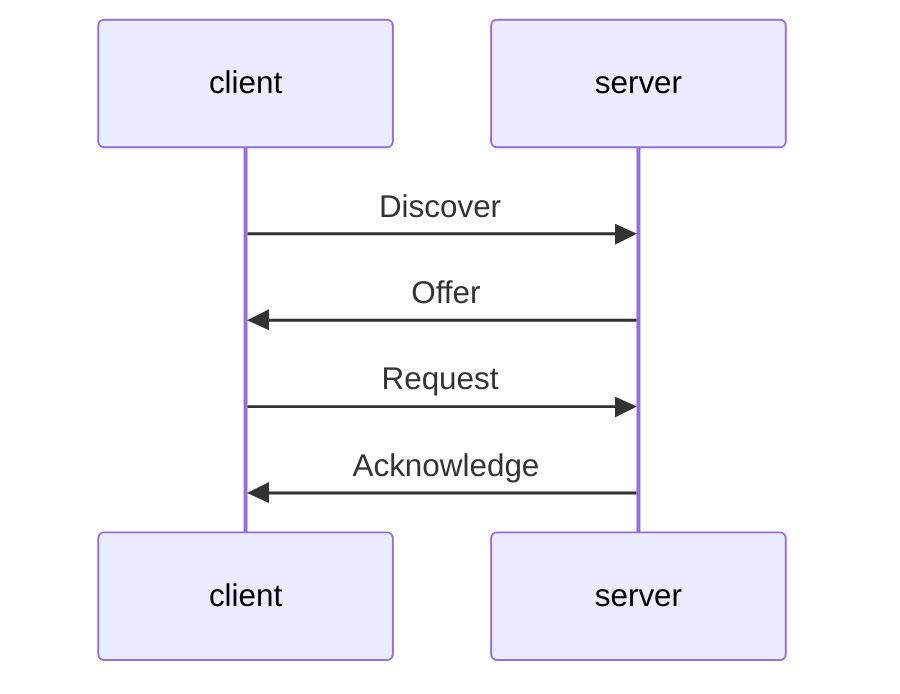

# The Lease Conversation

Astronaut, a ship that arrives in the harbour has no call sign yet, so it cannot address anyone. It shouts into the open lane, and the harbour master answers. This part walks through that conversation and what the answer contains.

## Four steps: Discover, Offer, Request, Acknowledge

A DHCP exchange has four messages. Remember them as **DORA**.

| Step | Who talks | What is said |
| --- | --- | --- |
| Discover | client to everyone | "I need a call sign. Is a harbour master here?" |
| Offer | server to client | "You may have `10.77.0.101`." |
| Request | client to everyone | "I accept `10.77.0.101` from this harbour master." |
| Acknowledge | server to client | "Confirmed. It is yours for 10 minutes." |



The diagram shows the order of the four messages. The first and third go to everyone because the client has no address of its own yet. DHCP uses UDP port 67 on the server side and port 68 on the client side.

## What a lease carries

The Acknowledge message gives the client a **lease**. The lease is a loan, not a gift. It holds:

- the address and the prefix length (the size of the sector),
- the lease time, the length of the loan,
- the router, the default gateway for "everywhere else",
- the DNS servers and search domain, the directory to call,
- sometimes more, such as time servers or a host name.

### Renewing the loan

The client does not wait for the lease to run out. At half of the lease time it asks the same server to extend it (renewal). If that server is silent, at seven eighths of the time it asks any server (rebinding). If nobody answers before the end, the client must give up the address.

## Who runs the client on Ubuntu 24.04

On Ubuntu Server the DHCP client is built into `systemd-networkd`. Netplan only writes the settings, and the networking officer carries them out. On a desktop, NetworkManager does the same job. Older systems used a separate program called `dhclient`. Ubuntu 24.04 does not use it by default.

### See it in your playground

Open the playground and look at the two ends before anything is configured:

<!-- astrona:playground:renew -->

```sh
ip -br addr show dhcpsrv0
ip -br addr show dhcp0
```

The server end has `10.77.0.1/24`. The client end has no IPv4 address yet. List what `systemd-networkd` knows:

```sh
networkctl list
```

`dhcpsrv0` is managed by `networkd`. `dhcp0` shows as `unmanaged` or `off`, because no Netplan file mentions it. The next part gives it one.

## Common pitfalls

> [!WARNING]
> - **Thinking a lease is permanent.** The address can change when the lease ends, and a new server may hand out a different one. Use a static address for a server that others must find.
> - **Two harbour masters.** Two DHCP servers on one segment can hand out clashing answers.
> - **Expecting DHCP to work on a bare antenna.** An interface without a carrier (no cable, no link) gets nothing.
