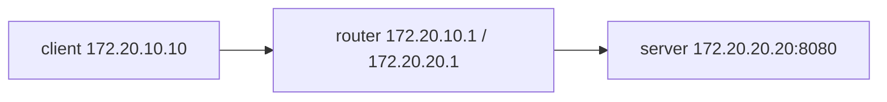

# Forward, filter and translate

The playground has a client at `172.20.10.10`, a router with `.1` on each subnet, and a server at `172.20.20.20`. The client route points at the router. The server has no route to `172.20.10.0/24`.



On the router, inspect `ip -br address`, `ip route` and `sysctl net.ipv4.ip_forward`. Forwarding is initially off. Create `/etc/sysctl.d/90-lfcs-router.conf` with `net.ipv4.ip_forward=1`, then load that file with `sudo sysctl -p /etc/sysctl.d/90-lfcs-router.conf`.

Forwarding alone cannot provide the missing return path. **Masquerade** replaces the client source with the router's outgoing interface address. Connection tracking remembers the original tuple and reverses the translation for replies. The server therefore responds to the router on its own subnet. With a fixed outgoing address you could also use `snat to`; masquerade follows the interface address.

Find the inside and outside interface names with `ip -br address`. Write `/etc/nftables.conf`, replacing `INSIDE` and `OUTSIDE` below with those names:

```nft
flush ruleset
table inet filter {
  chain forward {
    type filter hook forward priority filter; policy drop;
    ct state established,related accept
    iifname "INSIDE" oifname "OUTSIDE" ip saddr 172.20.10.0/24 ip daddr 172.20.20.20 tcp dport 8080 accept
  }
}
table ip nat {
  chain postrouting {
    type nat hook postrouting priority srcnat; policy accept;
    oifname "OUTSIDE" ip saddr 172.20.10.0/24 masquerade
  }
}
```

The forward hook sees packets passing through the router. Input rules would inspect packets addressed to the router itself. Postrouting performs translation after the route has selected an outgoing interface. Restrict both the input subnet and outgoing interface so management traffic is unaffected.

Check syntax before applying the file:

```bash
sudo nft -c -f /etc/nftables.conf
sudo nft -f /etc/nftables.conf
sudo systemctl enable nftables
```

The file replaces the ruleset inside this disposable playground. On a shared host, first inspect existing rules and coordinate changes with the service that owns them.

From the client, `curl --max-time 4 http://172.20.20.20:8080/` must return the router's outside address. The same request to port 8081 must time out. Check both listeners locally on the server to distinguish a firewall drop from a stopped service. Finally reboot the router and repeat: a successful live change does not prove that sysctl and nftables reload at boot.

The automated lab test removes the NAT table, then disables forwarding in a separate case. Each must break the allowed request. It restores the solution between cases and repeats the checks after reboot.

Reference: [nftables manual](https://netfilter.org/projects/nftables/manpage.html).
