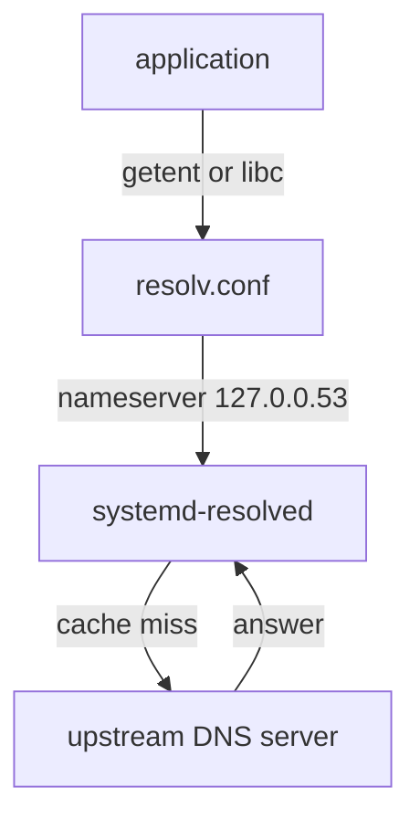

# The Stub Resolver

Astronaut, when you look at `/etc/resolv.conf` on Ubuntu 24.04, you do not find a real directory server. You find the address of a small clerk on your own ship. This part shows who that clerk is and how to ask the clerk questions.

## 127.0.0.53: the clerk at the door

`systemd-resolved` runs on your ship and listens on `127.0.0.53`, a loopback address that no one outside can reach. Programs that read `/etc/resolv.conf` send their questions there. The clerk collects the real directory servers from the network settings, asks them, and keeps answers in a cache.



The picture shows an application asking the local stub, which asks the upstream server only when its cache does not have the answer.

### See it in your playground

<!-- astrona:playground:renew -->

Look at the file the programs read, and where it really points:

```sh
ls -l /etc/resolv.conf
cat /etc/resolv.conf
```

On a default Ubuntu 24.04 ship, `/etc/resolv.conf` is a symbolic link to `/run/systemd/resolve/stub-resolv.conf` and it has the line `nameserver 127.0.0.53`. The file is generated by the system. Do not edit it by hand, because the next restart replaces your changes.

The list of the real servers is in a second file:

```sh
cat /run/systemd/resolve/resolv.conf
```

## resolvectl: ask the clerk

`resolvectl` is the console for the clerk. `resolvectl status` shows the servers and search domains, globally and for each interface.

### Read the status and run a query

```sh
resolvectl status
resolvectl query www.lab.example
```

In the status output look for the `Global` block and for the `Link` blocks, each with `DNS Servers` and `DNS Domain` lines. The query command reports the answer and which server gave it. In this playground the clerk does not know the server `10.55.0.53` yet, so the query for `www.lab.example` fails. The next part fixes it.

When you change the servers, old answers may still sit in the cache. Clear it:

```sh
sudo resolvectl flush-caches
```

## Common pitfalls

> [!WARNING]
> - **Editing `/etc/resolv.conf`.** It is a generated link on Ubuntu. Change the settings in Netplan or a `resolved.conf.d` drop-in instead.
> - **Reading `127.0.0.53` as a server.** It is the clerk on your own ship. Use `resolvectl status` to see the real servers.
> - **Stale cache.** After a change, run `sudo resolvectl flush-caches`, then test again.
