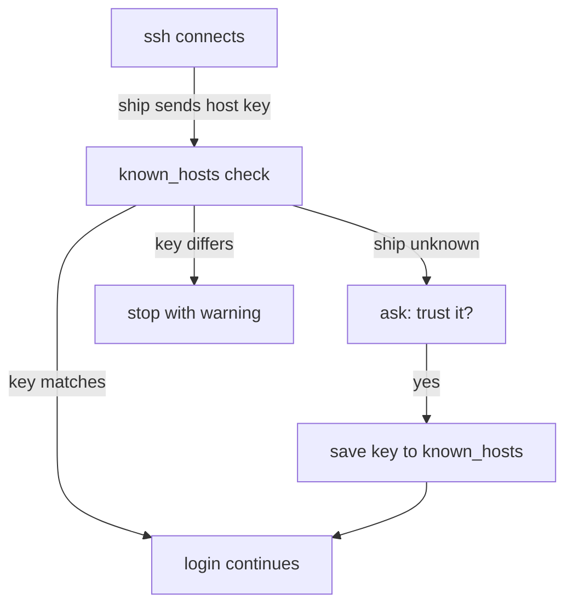

# Keys, ssh-copy-id And Known Hosts

Astronaut, a password is something a thief can guess or watch you type. A key pair is a keycard: the private half never leaves your ship, and the other ship only holds a lock that fits it. This part shows you how to make the card, hand the lock to the other ship, and how your ship remembers which ships it has met before.

## The key pair

An SSH key pair has two files. The **private key** is your keycard. The **public key** is the lock. You can give the lock to anyone, but you must never share the card.

### Make a key pair

<!-- astrona:playground:renew -->

Open a shell as the visitor user and create a key with the modern `ed25519` type. The `-N ''` option gives it an empty passphrase, which is fine for a playground:

```sh
sudo -iu cadet
ssh-keygen -t ed25519 -N '' -f ~/.ssh/id_ed25519
```

`ssh-keygen` writes two files. `~/.ssh/id_ed25519` is the private key. `~/.ssh/id_ed25519.pub` is the public key, one line of text. List them to see the permissions:

```sh
ls -l ~/.ssh
```

The private key must be readable only by you (mode `600`). If it is not, `ssh` refuses to use it.

### Protect the key with a passphrase

On a real ship you add a passphrase, so a stolen file is useless without it. Typing it for every login is tiring, so `ssh-agent` holds the unlocked key in memory and `ssh-add` loads it. The agent is the quartermaster who keeps your unlocked keycard in a locker until you log out.

## Install the public key with ssh-copy-id

The remote ship must hold your public key in the file `~/.ssh/authorized_keys` of the account you want to enter. `ssh-copy-id` does that for you over a normal password login.

### See it in your playground

Copy your key to the user `pilot` on the station. The `-p` option names the port. Type `yes` when `ssh` asks about the host key, then give the password `pilotpass`:

```sh
ssh-copy-id -p 2222 pilot@localhost
```

Now log in. No password should be asked:

```sh
ssh -p 2222 pilot@localhost hostname
```

The command prints the ship's host name. If it still asks for a password, the key was not accepted. Run it again with `-v` to see which keys `ssh` offered.

Behind the scenes `ssh-copy-id` appended your public key line to `/home/pilot/.ssh/authorized_keys` on the remote side and made sure the directory and file have safe permissions.

## Known hosts: remembering the ships you trust

The first time you connect to a ship, `ssh` shows its **host key fingerprint** and asks whether you trust it. If you say yes, `ssh` writes the key into `~/.ssh/known_hosts`. This file is your star log of trusted ships.

### What the check protects you from

Next time, `ssh` compares the key the ship presents with the one in the log. If they differ, `ssh` stops with a loud warning, `WARNING: REMOTE HOST IDENTIFICATION HAS CHANGED!`. That could mean someone is pretending to be your ship. It can also mean the ship was rebuilt.



The flow shows the three outcomes of the host key check: match, unknown ship and changed key.

### Look up and remove a log entry

Ubuntu hashes the host names in `known_hosts`, so the file is not readable as plain text. Ask for an entry by name with `-F`:

```sh
ssh-keygen -F '[localhost]:2222'
```

Entries for a port other than 22 are written in the form `[host]:port`. When a ship is really rebuilt, remove the old entry and connect again. Never turn the check off:

```sh
ssh-keygen -R '[localhost]:2222'
```

To collect a ship's key without logging in, use `ssh-keyscan -p 2222 localhost`. Compare the fingerprint with one you got from the ship's owner before you trust it.

## Common pitfalls

> [!WARNING]
> - **Wrong permissions.** A private key that other users can read is ignored, and `~/.ssh` must not be writable by others. Use `chmod 700 ~/.ssh` and `chmod 600 ~/.ssh/id_ed25519`.
> - **Forgetting the port.** `ssh-copy-id` and `ssh` use `-p`, but `scp` uses a capital `-P`.
> - **Switching the check off.** `StrictHostKeyChecking no` removes the only protection against a fake ship. Use `ssh-keygen -R` and check the new fingerprint instead.
> - **Sharing the private key.** Only the `.pub` file ever leaves your ship.
