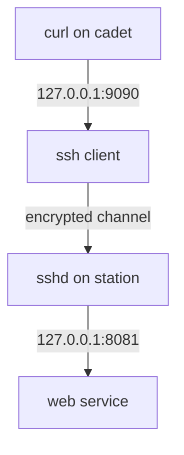

# Tunnels Through The Channel

Astronaut, an SSH channel is a sealed pipe between two ships. You can feed other traffic into the pipe. This is called **port forwarding** or a **tunnel**. It lets you reach a service that hides behind a ship, using the pipe's encryption and the ship's own login.

## Local forward: bring a far channel to my ship

A local forward (`-L`) opens a port on **your** ship. Everything you send to it travels through the pipe and comes out on the far side, which then talks to the target you named.



The picture shows how a request travels from a local port, through the channel, to a service that listens only on the far ship's loopback.

### See it in your playground

The web service listens on `127.0.0.1:8081` only. Open a tunnel from local port 9090 to it. `-N` means "run no command", and `-f` sends `ssh` to the background after login. Use the nickname from the last part, or the full options if you skipped it:

<!-- astrona:playground:renew -->

```sh
ssh -f -N -L 9090:127.0.0.1:8081 -p 2222 pilot@localhost
```

Check who listens on 9090, then use it:

```sh
ss -tlnp 'sport = :9090'
curl http://127.0.0.1:9090/
```

`ss` shows an `ssh` process as the owner of the listener. The `curl` answer comes from the web service. In a real setup the service would run on a different ship, which is why the target is named from the far ship's point of view.

Close a background tunnel by finding its process and stopping it:

```sh
pkill -f 'ssh -f -N -L 9090'
```

## Remote forward: open a channel on the far ship

A remote forward (`-R`) is the mirror image. The **far** ship opens a port, and traffic sent to it travels back through the pipe to a target your ship can reach. Use it to let a remote ship reach a service that only your ship can see.

### The syntax

```text
ssh -R 9091:127.0.0.1:8081 pilot@localhost -p 2222
```

Read it as "on the far side listen on 9091, and send the traffic back to `127.0.0.1:8081` as seen from here". The far `sshd` binds remote forwards to its loopback address by default. Only the setting `GatewayPorts` on the server changes that.

## Dynamic forward: a SOCKS proxy

A dynamic forward (`-D`) turns the local port into a **SOCKS proxy**. A program that speaks SOCKS, such as `curl --socks5-hostname`, can then reach any address the far ship can reach. The far ship decides where each connection goes.

```sh
ssh -f -N -D 1080 -p 2222 pilot@localhost
curl --socks5-hostname 127.0.0.1:1080 http://127.0.0.1:8081/
```

## Common pitfalls

> [!WARNING]
> - **Reading the target from the wrong side.** In `-L 9090:127.0.0.1:8081`, the target `127.0.0.1` is the far ship's own loopback, not yours.
> - **Port already in use.** If the local port is taken, `ssh` prints `bind: Address already in use`. Pick another port or find the holder with `ss -tlnp`.
> - **A forward the server forbids.** If the server sets `AllowTcpForwarding no`, the tunnel opens but traffic is refused.
> - **Forgetting to close it.** A tunnel started with `-f` keeps running after your shell ends.

## Your mission: OpenSSH Client Lab

You can now make a key, install it, write a `Host` block and open a tunnel. The graded mission gives you a fresh ship where you do the whole client workflow yourself: create a key, copy it to the station, trust the host key, write a `Host station` entry and keep a tunnel open to the loopback-only web service.

The mission runs on its own training ship, so first pause your playground. Nothing in it is lost:

```sh
astrona stop ssh-client-playground
```

Then start the mission:

```sh
astrona run --git ssh://git@github.com/astrona-io/ATS003.git -c sections/section-050/module-04/labs/lab-01
```

Read the task in [`question.md`](./labs/lab-01/question.md) and solve it on your own first. When you think you are done, send it for grading:

```sh
astrona submit -c sections/section-050/module-04/labs/lab-01
```

When the mission is done, remove it and wake your playground up again:

```sh
astrona destroy ats-003-lab-054
astrona start ssh-client-playground
```
