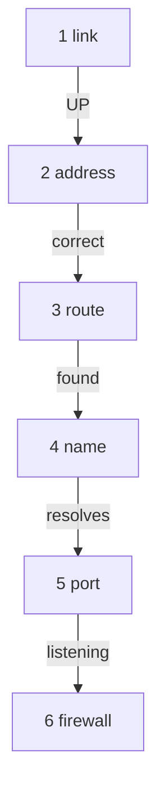

# Work Up The Ladder

Astronaut, a signal has to pass six checkpoints on its way out of your ship. If one of them fails, everything above it fails too. So you check them in order, from the bottom, and you stop at the first one that is broken.

## The six rungs

Each rung has one question and one command that answers it.

| Rung | Question | Command |
| --- | --- | --- |
| 1. Link | Is the antenna switched on and does it have a carrier? | `ip -br link` |
| 2. Address | Does it have the right call sign? | `ip -br addr` |
| 3. Route | Which lane does a signal to the target take? | `ip route get <address>` |
| 4. Name | Does the name turn into the right address? | `getent hosts <name>` |
| 5. Port | Is something listening on the radio channel? | `ss -tlnp` and `curl -v` |
| 6. Firewall | Do the shields let the signal through? | `sudo nft list ruleset` |



The ladder shows the order of the checks. A failure at one step is fixed before you look at the next.

### See it in your playground

Run the three lower rungs for the healthy ship first. This is what "good" looks like.

<!-- astrona:playground:renew -->

```sh
ip -br link show lab0
ip -br addr show lab0
ip route get 10.66.0.10
```

`lab0` is `UP` (a dummy interface may also show `UNKNOWN`, because it has no real carrier), it has `10.66.0.10/24`, and the route for `10.66.0.10` goes through the local table. Now the upper rungs:

```sh
getent hosts portal.lab
curl -s -o /dev/null -w '%{http_code}\n' http://portal.lab:8443/
```

The name resolves to `10.66.0.10` and `curl` prints `200`.

## What the error message tells you

You do not always need the whole ladder. The error text often names the rung.

| Message | Rung | Meaning |
| --- | --- | --- |
| `Name or service not known` | 4 name | the name did not turn into an address |
| `Network is unreachable` | 1 to 3 | no lane to the target, or the antenna is down |
| `No route to host` | 2 to 3 | the lane exists but nobody answers for that address on it |
| `Connection refused` | 5 port | the ship answered, but nothing listens on that channel |
| a long timeout | 6 firewall | signals leave and nothing comes back |

### Break the ladder on purpose

The playground can break one rung at a time. Break the firewall rung and watch the message change:

```sh
sudo break-firewall
curl -m 5 -s -o /dev/null -w '%{http_code}\n' http://portal.lab:8443/
```

`curl` gives up after 5 seconds and prints `000`. A timeout points to the firewall rung. Put everything back before the next part:

```sh
sudo fix-all
```

## Common pitfalls

> [!WARNING]
> - **Skipping rungs.** Changing the firewall before you have checked the link wastes time. Go in order.
> - **Trusting `UP` alone.** `UP` in the `<...>` flags means the administrator switched the antenna on. `LOWER_UP` means a carrier is present.
> - **Testing a name with `dig` only.** `dig` asks the directory and ignores `/etc/hosts`. `getent hosts` asks the same way applications do.
> - **Fixing two things at once.** Change one thing, test, then move on.
